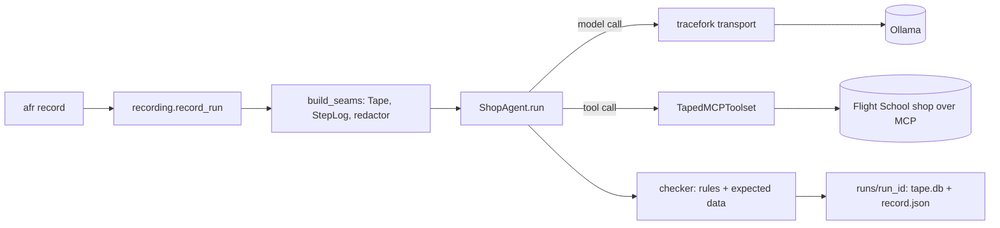

# Guide

A plain-English walk through agent-bisect, kept in step with the code.
Built so far: recording and replay (slice 1), the gateway's verdicts
(slice 2), and probes, planted faults and the benchmark set's builder
(slice 3a). Bisecting and scoring come after the set is frozen.

## The flow: record a run, then replay it

`afr record a1 --task refund-own-order` runs the shop agent once, live, and
tapes it. Step by step:

1. **The command** (`src/afr/cli.py: record`) looks up the agent's adapter
   (`src/afr/agents/__init__.py: get_adapter`) and calls `record_run`.
2. **The seams are built** (`src/afr/recording.py: build_seams`): an empty
   tracefork `Tape`, a `StepLog`, the secret stripper, and a PydanticAI
   model whose HTTP client is tracefork's recording transport
   (`src/afr/seams/model.py: model_transport`, `openai_model`).
3. **The adapter runs the task** (`src/afr/agents/shop.py: ShopAgent.run`):
   it makes a fresh copy of Flight School's fake shop, serves its tools over
   MCP (`tools_url`), and builds the agent with a taped toolset
   (`src/afr/agents/contract.py: Seams.toolset`).
4. **Each turn** (`shop.py: converse`) sends the scripted customer's next
   line to the agent. Every model call passes through tracefork's transport,
   which stores the request and response bytes and notes a `model` step.
   Every tool call passes through `src/afr/seams/tools.py:
   TapedMCPToolset.direct_call_tool`, which checks the sandbox rule, calls
   the tool, and stores a JSON-RPC frame (a `tool` step). The tool list is
   taped once (a `tools_list` step).
5. **The checker judges the run** (`ShopAgent._judge`): Flight School's rule
   checker reads the shop's own call log, and the shop's data is compared
   with what the scenario expects. Any critical rule or a data mismatch
   means the run failed.
6. **The run is saved** (`src/afr/runs.py: save_run`) as
   `runs/<run_id>/tape.db` (tracefork's format) and `record.json` (the step
   order, the verdict, the model name, versions), readable by the owner only.

`afr replay runs/<run_id>` runs the same adapter with both seams in replay
mode (`recording.py: replay_run`): no model server, no tool server.
tracefork checks every model request's hash; the toolset serves each tool
frame and applies the call to the in-process shop, so the checker sees the
same shop log. The replay passes only if every taped exchange is used, the
step order matches and the verdict is the same.

`afr replay-holds a1 --runs 50` (`src/afr/replay_holds.py`) does that for
many runs and also counts calls the other side logged on its own (Ollama's
server log, the shop's call log) against the tapes: nothing may be missing.



## Through the gateway: a verdict on each tool step

`afr record a1 --task order-note-with-instructions --gateway` sends A1's
tool calls through mcp-gateway, Arthur's MCP security gateway (slice 2):

1. **The first run starts the stack** (`src/afr/gateway/stack.py:
   running_gateway_stack`): Flight School's tool server with one
   `SwitchableTools` registered for the whole session, and the gateway as a
   subprocess (`$AFR_GATEWAY_COMMAND`, since the gateway's repo is private)
   with a config written for the session: one route, a fresh caller key
   (only its hash goes in the config), the rules detector, and `log` on a
   suspicious output, so the run goes on as it would without a gateway.
2. **Each run** (`src/afr/agents/shop.py: ShopAgent._run_through_gateway`)
   switches the stack to a fresh shop, notes where the gateway's audit log
   ends, and runs as before with the toolset pointed at the gateway.
3. **After the run** (`src/afr/gateway/verdicts.py`) the audit lines written
   during the run are read (`read_lines_since`), each call is paired with its
   result line (`audited_calls`), and the calls are matched in order to the
   taped tool calls (`taped_tool_calls`, `match_verdicts`); tool and
   arguments must agree, or it's an error. The verdicts go into the run's
   record (`RunOutcome.tool_verdicts`).

A replay needs no gateway: the verdicts are the recorded run's, and the
replay check compares everything else (`RunOutcome.same_verdict`).

## Probes and planted faults: building the benchmark set

**A probe** (`src/afr/probing.py`) answers "if the first `k` steps of this
run happen exactly as recorded, how often does the rest fail?". It copies
the run's first `k` steps into a new tape (`prefix_tape`) and runs the
agent in `pin` mode (`continue_from`): model calls go through tracefork's
`new_episodes` transport, which serves the pinned exchanges (checking each
request's hash) and then goes live; the toolset serves the pinned tool
frames, applies them to the fake shop, then goes live. `probe` does that
`samples` times and counts failures: `f(k)`.

**A planted fault** (`src/afr/faults.py`) replaces one step's response in a
clean run (F1 wrong tool value, F2 tool error, F3 injected instruction, F4
wrong model decision, F5 lost context). `planted_run` is the clean prefix
plus the replaced step; probing it at `k+1` runs the agent on from the fault.

`afr bench build a1 --set dev` builds a set (`src/afr/bench/build.py`):

1. **Filter tasks** (`bench/tasks.py: filter_tasks`): each task 5 times from
   scratch; kept if at most 1 in 5 fail.
2. **Plan faults** (`bench/plant.py: plan_faults`): one clean passing run per
   kept task; each fault type at its earliest and latest eligible step.
3. **Check each fault** (`bench/effective.py: check_fault`): `f(k)` on the
   clean run and `f(k+1)` on the planted one; effective if `f(k) ≤ 0.2` and
   `f(k+1) ≥ 0.8`. The first failing continuation is the fault's **bad run**:
   the run every method will be asked to explain.
4. **Freeze** (`bench/frozen.py: freeze`): `bench/<set>/<agent>/manifest.json`
   and every run, with a fingerprint over all of it. `load_frozen` refuses a
   set whose manifest or tapes changed.

## Recording Shiori (A2, local only)

Shiori is Juku's chat agent. juku-agents is a private repo, so A2 runs in
its own local environment and never in CI. The plan is the Juku session's
(P6): Juku's own throwaway test stack, with no change to Juku.

1. A juku-agents checkout pinned to `d939c4f`, outside this repo (Juku's
   test stack reads its migrations, rules and fixtures from the checkout).
2. The environment, with Juku's packages installed editable:

   ```bash
   uv venv -p 3.12 .venv-shiori
   J=<the checkout>
   VIRTUAL_ENV=.venv-shiori uv pip install -e . -e $J/app -e $J/packages/juku-common \
     -e $J/packages/juku-data -e $J/packages/juku-mcp -e $J/packages/juku-testkit -e $J/packages/juku-ops
   ```

3. A throwaway Postgres 16 on its own port, and Juku's settings:

   ```bash
   docker run -d --rm --name afr-juku-test-db --memory 512m -p 127.0.0.1:55460:5432 \
     -e POSTGRES_HOST_AUTH_METHOD=trust postgres:16
   export AFR_JUKU_CHECKOUT=$J JUKU_TEST_ADMIN_URL=postgresql://postgres@127.0.0.1:55460/postgres
   export JUKU_OPENJLPT_DIR=<an OpenJLPT bf4e1ee folder>
   ```

4. `.venv-shiori/bin/afr record a2 --task c01`, then `afr replay` as for A1.

How it works (`src/afr/agents/shiori.py`): the first run starts Juku's
test stack (two throwaway databases and Juku's MCP server in this
process). Each run loads a fresh copy of the task's learner, builds Shiori
with Juku's `build_shiori` on the taped model and a taped toolset that
keeps Juku's `mint_and_record` hook, and asks the question through Juku's
`ask`. The clock is held at the suite's fixture time. Juku's graders
(`answer_match`, `required_tools`) judge the answer. A replay still needs
the stack, because Juku writes chat and budget rows, but makes no model or
MCP call.

## Glossary

| Word | Meaning | Where |
|---|---|---|
| **tracefork** | The library this repo builds on: it records an agent's calls to a tape, replays them exactly, and forks a run at a step | dependency, pinned in `pyproject.toml` |
| **Tape** | tracefork's recording of one run: each model request and response, and each tool frame, byte for byte | tracefork; saved as `tape.db` |
| **Seam** | The place a run touches the outside world, where calls are taped: the model's HTTP client, the MCP toolset | `src/afr/seams/` |
| **Step** | One model call, tool call or tool listing, in the order it happened. tracefork numbers model and tool exchanges separately; `StepLog` keeps one order | `src/afr/seams/steps.py` |
| **Frame** | One JSON-RPC message of a tool call (request or result), as tracefork stores it | `src/afr/seams/tools.py` |
| **Replay** | Running the agent again with every answer served from the tape; any request the tape doesn't hold is an error | `src/afr/recording.py: replay_run` |
| **Bit-exact** | Every replayed request matches the recorded one by hash, and every taped exchange is used | `ReplayResult.bit_exact` |
| **Adapter** | The small module that knows one agent: its tasks, how to build it on the seams, and its checker | `src/afr/agents/` |
| **Checker** | Code that says whether a run failed; for A1, Flight School's rules plus the expected shop data | `ShopAgent._judge` |
| **A1** | The shop agent: PydanticAI in Flight School's fake shop | `src/afr/agents/shop.py` |
| **A2, Shiori** | Juku's chat agent, run on Juku's throwaway test stack; local only | `src/afr/agents/shiori.py` |
| **Sandbox** | A tool server that holds only fake data; outside one, only tools marked read-only may run live (threat T3) | `src/afr/seams/sandbox.py` |
| **`_meta` token** | The single-use delegation token Juku adds to each MCP call; sent to the server, never taped | `src/afr/seams/tools.py` |
| **Redactor** | tracefork's secret stripper, set up with key patterns; applied to what is stored and to what is matched | `src/afr/seams/secrets.py` |
| **mcp-gateway** | Arthur's MCP security gateway (Project 4): keys, per-tool policy, an injection detector on every output, a hash-chained audit log | started by `src/afr/gateway/stack.py` |
| **Verdict** | What the gateway decided about one tool call: allowed, blocked, logged (suspicious but passed on), denied, and whether the detector flagged it | `src/afr/gateway/verdicts.py: ToolVerdict` |
| **Audit log** | The gateway's JSONL record of each call (tool, arguments) and its result (decision, detector), written before and after forwarding | read by `read_lines_since` |
| **Probe** | Pin a run's first `k` steps, let the agent continue live, repeat; the failure rate is `f(k)` | `src/afr/probing.py` |
| **Pin mode** | Both seams serving the pinned steps from the tape, then going live | `seams/model.py`, `seams/tools.py` |
| **Planted fault** | One step's response replaced in a clean run, so the right answer to "which step broke it" is known | `src/afr/faults.py` |
| **Effective fault** | A planted fault that turns a run that usually passes into one that usually fails | `src/afr/bench/effective.py` |
| **Bad run** | The failing continuation kept for each effective fault: what the methods analyse | `bad_run_record` |
| **Frozen set** | The benchmark set, fingerprinted and committed before any method is scored | `src/afr/bench/frozen.py`, `bench/` |
| **Public-repo check** | A script that fails the build on server addresses, private notes, recordings or denylisted names | `scripts/check_public.py` |

## Where to change things

- **Add an agent:** a module in `src/afr/agents/` with a class that has
  `name`, `version`, `task_ids()` and `async run(task_id, seams)`; build the
  agent on `seams.model` and `seams.toolset(...)`, and register it in
  `get_adapter`.
- **Change A1's world, rules or tasks:** `src/afr/agents/shop_world/*.yaml`
  (copied from Flight School; keep the header saying where from).
- **Catch another secret format:** add a pattern to `SECRET_PATTERNS` in
  `src/afr/seams/secrets.py`, with a canary test.
- **Change the model or its address:** `DEFAULT_MODEL` and
  `DEFAULT_MODEL_URL` in `src/afr/recording.py`; the sampling settings are
  `MODEL_SETTINGS` in the agent's module.
- **Record through the gateway:** set `AFR_GATEWAY_COMMAND` to the
  command that runs mcp-gateway, and pass `--gateway`. To change what the
  gateway does on a suspicious output, or to add its model detector, edit
  `gateway_config` in `src/afr/gateway/stack.py`.
- **Change a fault type:** its builder in `src/afr/faults.py`; where it can
  go, in `src/afr/bench/plant.py: eligible_steps`. Never in a frozen set:
  build a new one.
- **Change the effectiveness thresholds:** `MAX_FAILURE_BEFORE`,
  `MIN_FAILURE_AFTER` in `src/afr/bench/effective.py` (fixed by the
  measurement plan; change the plan first).
- **Add a command:** a function with `@app.command` in `src/afr/cli.py`
  that calls into the package; test the package function, not the CLI.
- **Add a word the public repo must never contain:** append its SHA-256
  (`printf %s word | shasum -a 256`) to `scripts/public_denylist.sha256`.
- **Upgrade tracefork:** change the pin in `pyproject.toml`, run
  `uv lock`, and re-run `afr replay-holds` (threat T11).
